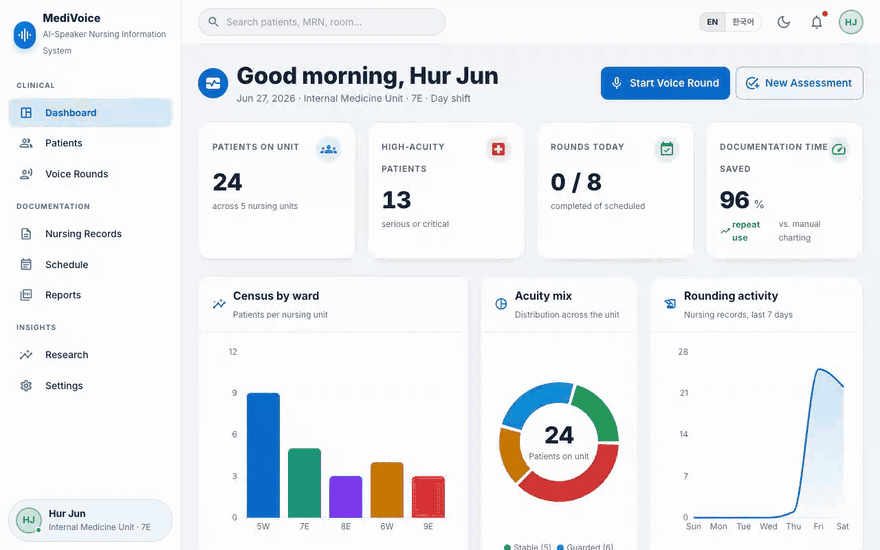

# MediVoice — an AI speaker asks, listens, and writes the nursing record

[](https://github.com/hurjun/stt-nursing-system/actions/workflows/ci.yml)
[](./LICENSE)

**[Open the live demo](https://stt-nursing-system.vercel.app)** · [Voice Rounds](https://stt-nursing-system.vercel.app/rounds) · [Research screen](https://stt-nursing-system.vercel.app/research)

Nurses spend a lot of time writing records. MediVoice tries a voice-first way. An AI speaker asks the patient a question (text-to-speech, "TTS"). The answer is transcribed (speech-to-text, "STT") and becomes a nursing record. In our KCC 2024 paper, this cut repeated documentation time by up to 96%.

## Result

All numbers are from the paper, not re-measured here.

- Repeated assessment: documentation time 90 s → 4 s, up to 96% less (paper Table 2, simulated patient records).
- First use, including setup: 109 s → 33 s, 70% less (paper Table 2, same conditions).
- STT choice: 4 Korean engines on one reference sentence, noise-free. Mis-transcribed characters: Google 0, Microsoft 1, Naver Clova 1, ETRI 4.
- Google STT: 0% character error rate on that sentence. Unit tests recompute this from the metric, not stored numbers.
- Pass criterion was set in advance at 80% character agreement. Women in their eighties fell to 57–77% on several question types.

<p align="center">
  
</p>
<p align="center"><sub>Dashboard → roster → chart → AI-speaker Voice Rounds. Production build; Voice Rounds in simulation mode.</sub></p>

## Paper

H. Choi, Y. Kim, J. Hur, J. Park. "Research on Work Efficiency Using AI Speaker-based Nursing Record Assistance System." KCC 2024 (KIISE), pp. 2015–2017. [PDF](https://hurjun.github.io/asset/kcc2024-kiise-nursing-record-paper.pdf). I (Jun Hur) was third of four authors: system implementation and evaluation design. Advisor: Prof. Jihun Park, Chungnam National University.

This repo is a 2026 re-implementation of that system, built after the paper as an interactive demo. It uses the browser's speech API, not the paper's Google STT and bedside smart speaker.

All patients, vitals and lab values are **synthetic** (faker), for demonstration only.

## How it works

- Voice loop: TTS asks → patient answers → STT transcribes (with confidence score) → `normalizeAnswer()` builds the record phrase.
- The record enters a Zustand store, then the patient chart, the schedule, and a jsPDF report.
- Patient charts: vitals trends, labs with reference-range flags, medications and MAR (medication administration record), Braden/Morse/GCS risk scales, care plan.
- Nursing terms use NANDA (diagnoses), NOC (outcomes) and NIC (interventions), standard nursing vocabularies.
- Client-only single-page app; English/Korean UI; light and dark theme.

This project gave me a habit for cyber-physical reliability work. Define the error metric, set the pass threshold first, and report the failing group.

## Run it

```bash
npm install
npm run dev        # http://localhost:5173
npm test           # Vitest suite, 95 tests in 7 files
npm run build      # type-check and production build
```

Requires Node.js ≥ 18.18. STT uses the browser's Web Speech API (best in Chromium browsers). Without it, Voice Rounds uses simulation mode. CI (GitHub Actions, Node 20) runs `typecheck → lint → test → build` on every push.

## Limitations

- The paper's time study used simulated patient records, not clinical data. Walking times were estimated from published adult walking speeds (45.5 m corridor).
- The STT benchmark is one sentence, noise-free. It is a selection test, not a general accuracy claim.
- The Research screen also shows items not in the paper: per-engine latency in ms and a 20s/50s/80s pass-rate table. Treat those as illustrative; the paper is the source of truth.
- No backend, no real EMR integration, no clinical validation.

## More

- [Details](docs/DETAILS.md): all screenshots, sample PDF report, tech stack, architecture, project tree, test and CI notes.

## License

[MIT License](./LICENSE).

— Jun Hur · [portfolio](https://hurjun.github.io) · [KCC 2024 paper](https://hurjun.github.io/asset/kcc2024-kiise-nursing-record-paper.pdf) · hurjun96@gmail.com
