# MediVoice — Details

Material moved out of the short [README](../README.md). It holds the full screenshot walkthrough, the sample PDF report, the tech stack, the architecture, the project tree, and testing notes.

## Walkthrough

### Unit dashboard

Census, acuity mix, 7-day rounding activity and a live critical-patient watchlist.

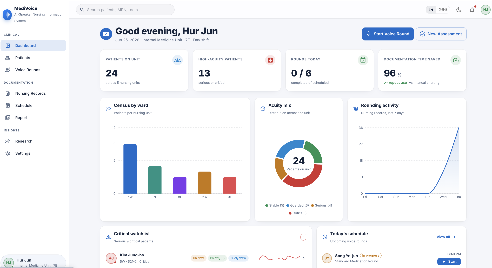

### Light and dark clinical theme

The UI ships with a dark theme alongside light. The same dashboard in dark mode:

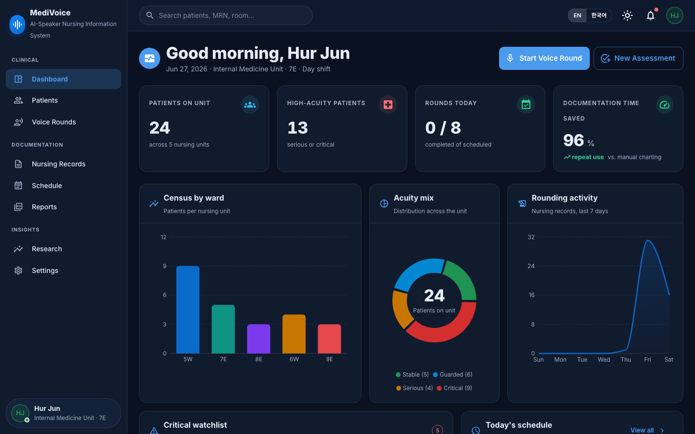

### Patient roster

Filter the unit by ward, acuity or free-text search; every row opens the full chart.

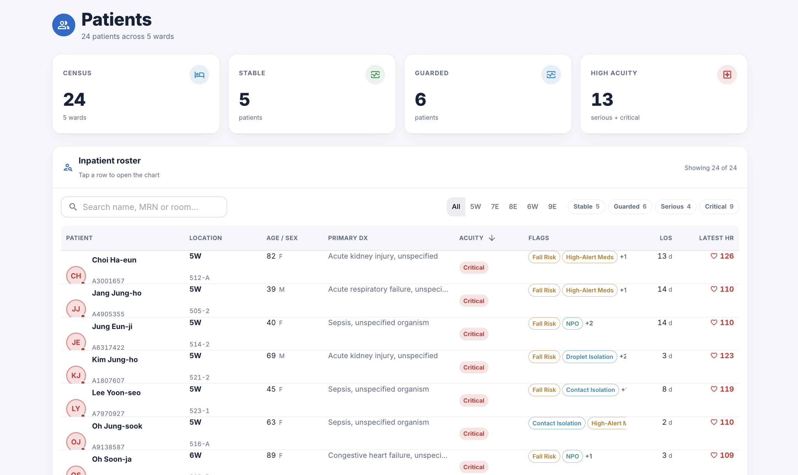

### EMR-style patient chart

Vitals trends, labs with reference-range flags, medications and MAR (medication administration record), NANDA diagnoses, assessment scales, care plan and records, organized into tabs. An allergy and risk-flag banner sits on top.

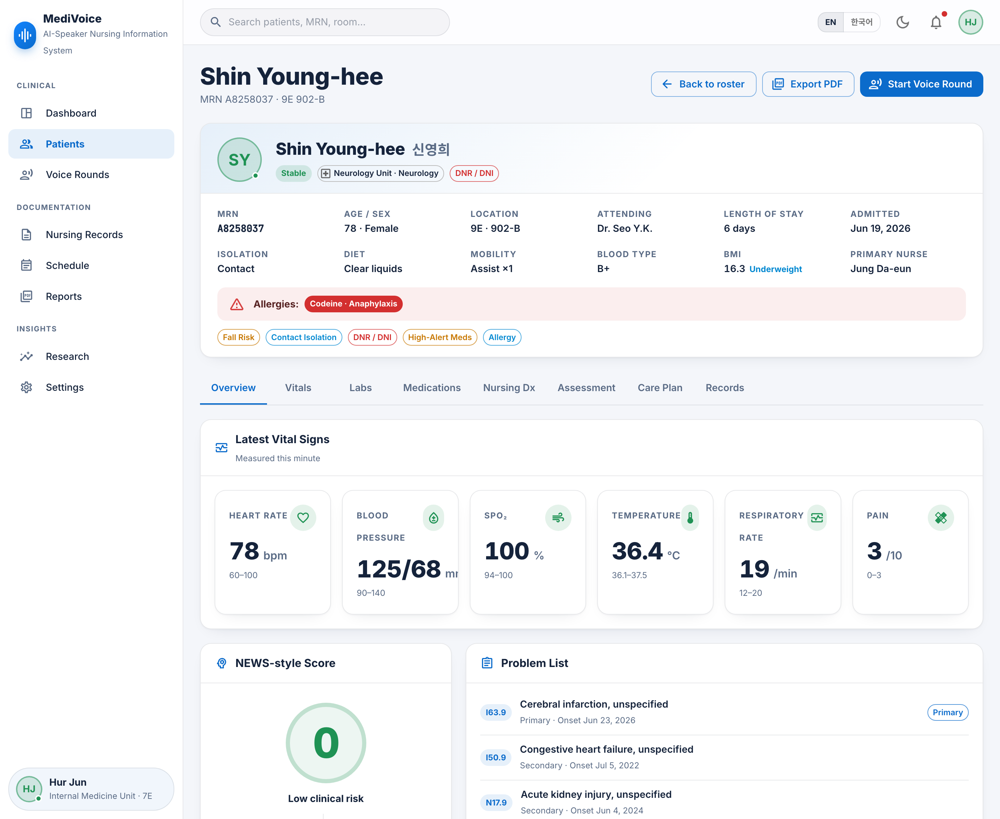

### Voice rounds ([try it live](https://stt-nursing-system.vercel.app/rounds))

The AI speaker asks each question aloud (TTS). The patient's reply is transcribed (STT) with a confidence score. It is then normalized into a chart-ready nursing entry. A built-in simulation mode keeps the demo working without a microphone.

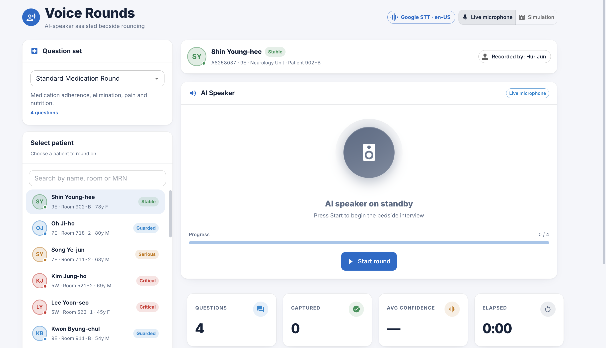

### Nursing records

Browse rounding and SOAP records, review the question-by-question transcript, then sign and export.

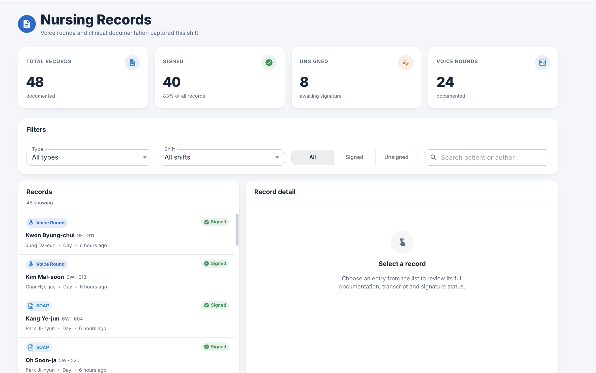

### Schedule

Plan rounding sessions with date/time pickers and track the day's timeline by hour.

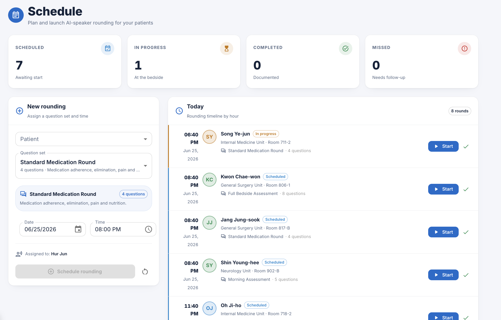

### Reports

Live PDF preview and one-click export of clinical documents.

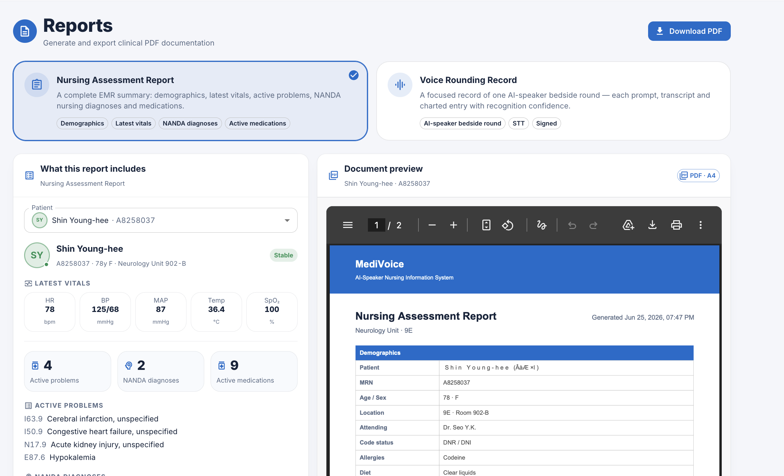

### Research ([open live](https://stt-nursing-system.vercel.app/research))

The study behind the app: STT engine benchmark, time study (≈96% reduction on repeated use) and recognition quality by patient age group. See the note under "Research data" below about which items come from the paper.

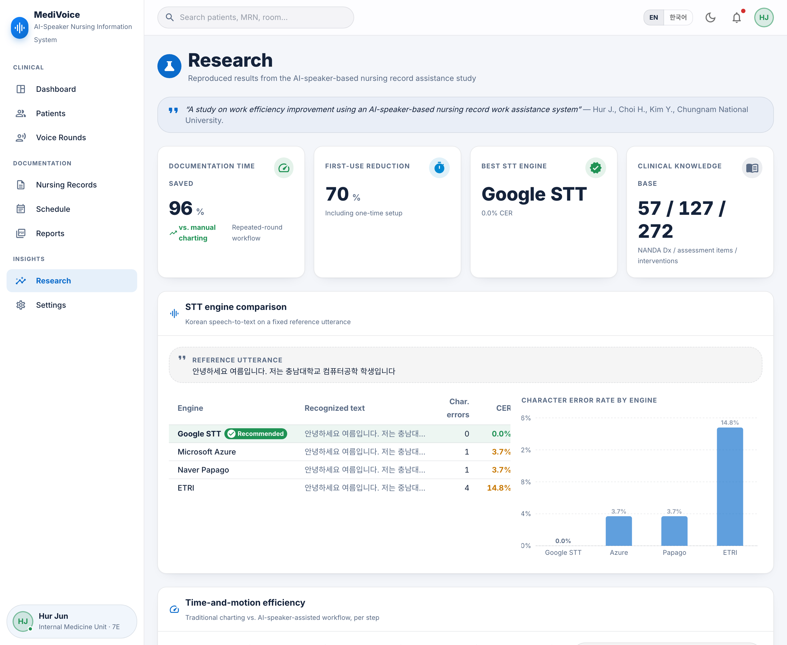

## Sample exported report

Generated entirely client-side with jsPDF. It is a structured nursing-assessment document with demographics, vitals, ICD-10 problems, the NANDA → NOC linkage and the medication list.

<table>
  <tr>
    <td width="50%">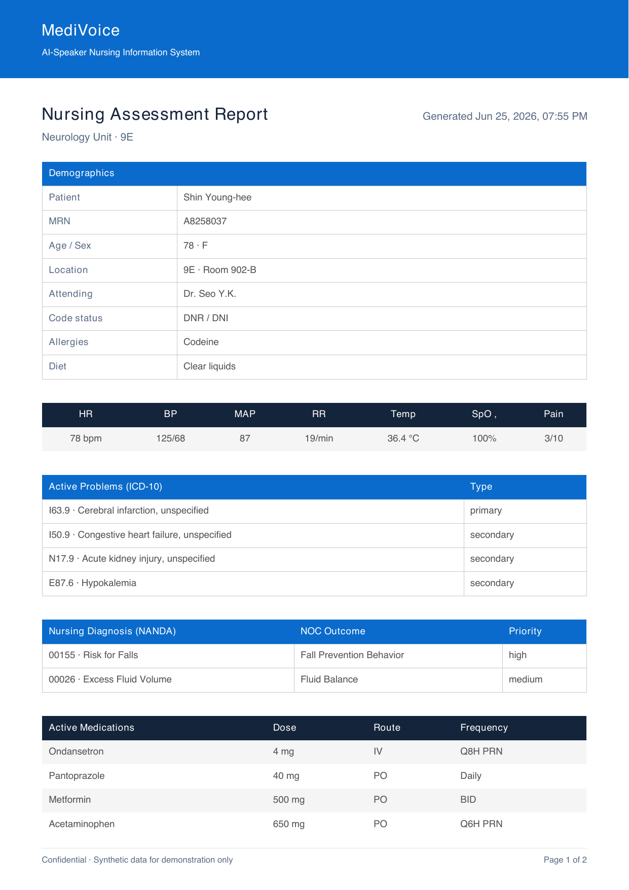</td>
    <td width="50%">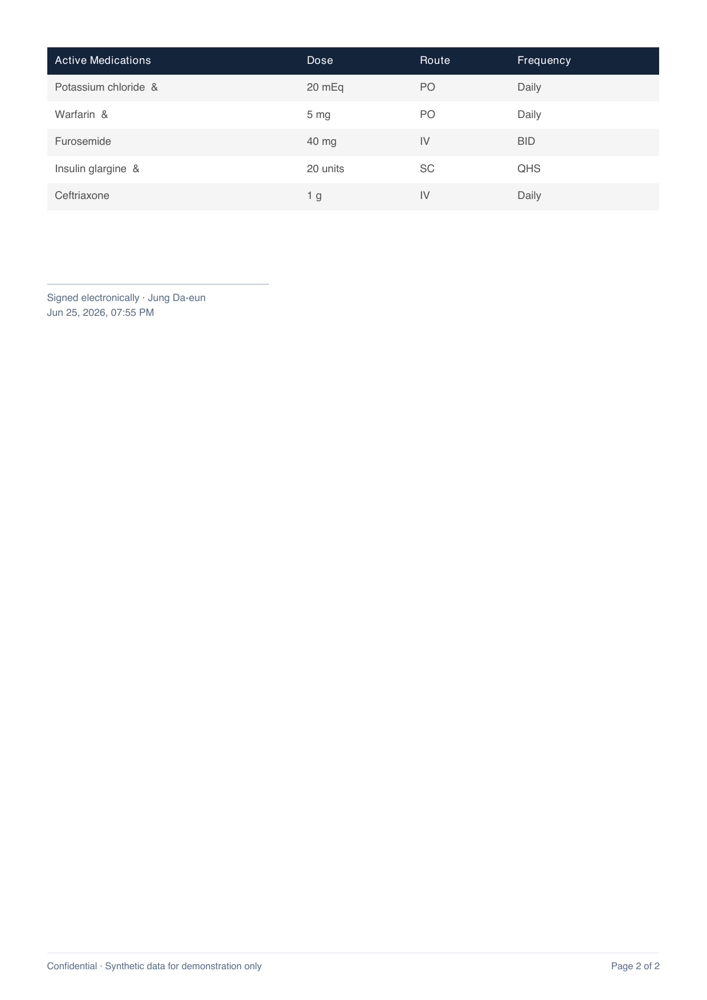</td>
  </tr>
</table>

[Download the full sample report (PDF)](sample-nursing-report.pdf)

## Research data

Source: H. Choi, Y. Kim, J. Hur, J. Park. "Research on Work Efficiency Using AI Speaker-based Nursing Record Assistance System." KCC 2024 (KIISE), pp. 2015–2017. [PDF](https://hurjun.github.io/asset/kcc2024-kiise-nursing-record-paper.pdf). Jun Hur was third of four authors (system implementation and evaluation design). Advisor and senior author: Prof. Jihun Park, Chungnam National University.

This repository is a 2026 re-implementation of the paper's system, built after the paper as an interactive demo (first commit June 2026). It uses the browser's Web Speech API plus a simulation mode. The paper's system used Google STT with a bedside smart speaker.

What the paper reports:

- Time study (Table 2): first use 109 s → 33 s (70%); repeated use 90 s → 4 s (96%). Typing, speech and response steps were measured directly and averaged over five trials. Ward-transit time was estimated, not measured: the paper assumes a published adult walking speed of 1.41 m/s over a 45.5 m corridor. The app's data file uses the same two values.
- STT engine selection: four Korean STT services on the same spoken sentence, noise-free. Mis-transcribed characters: Google 0, Microsoft 1, Naver Clova 1, ETRI 4. Google STT was selected.
- Pass criterion: 80% character-level agreement, computed as (1 − character error rate), set before testing.
- Recognition test: six participants, three age groups, both sexes, four question categories. Most groups passed. Women in their eighties scored 57–77% on several question types, below the criterion. The paper reports these shortfalls instead of averaging them away.
- Stated limitations (paper Section 6): simulated patient records rather than clinical data; walking times estimated, not measured on site.

The app's Research screen adds two items that are **not** in the paper. Treat them as illustrative: a per-engine latency column in ms, and a 20s/50s/80s pass-rate table with 20 utterances per group.

The benchmark tests in `src/lib/cer.test.ts` recompute each engine's CER from its character-error count and the reference length. They confirm the selected engine transcribes the reference sentence with zero errors.

## Tech stack

Clinical terminology follows the NANDA-I / NOC / NIC standardized nursing languages.

- React 18 + TypeScript 5 (strict), built with Vite 5
- MUI v5 design system + MUI X Data Grid and Date Pickers
- recharts for clinical data visualization
- Zustand for application state
- Web Speech API for STT/TTS, jsPDF for report generation
- faker for synthetic clinical data

## Architecture

MediVoice is a client-only single-page app organized into layers:

- a typed domain model (`types/`)
- curated clinical vocabularies and a seeded synthetic-data generator (`data/`)
- pure domain logic (`lib/`)
- a Zustand store (`store/`)
- one feature module per screen (`features/`)

The voice-rounds loop is the spine of the system:

```
   AI speaker ──TTS──►  patient  ──speech──►  STT (Web Speech API / simulation)
                                                   │  raw transcript + confidence
                                                   ▼
                                  normalizeAnswer()  ──►  structured, chart-ready phrase
                                                   ▼
                                       Nursing record  ──►  Zustand store
                                                   ▼
                  ┌────────────────────────────────┼────────────────────────────────┐
              Patient chart                  Rounding schedule                   PDF report
```

Three modules are pure functions with unit tests. They are transcript→structured-record normalization (`lib/rounding.ts`), clinical scoring and lab/vital flagging (`lib/clinical.ts`), and the character-error-rate metric behind the research benchmark (`lib/cer.ts`).

## Project structure

```
src/
├── app/          application shell, routing, layout
├── theme/        clinical MUI theme (light/dark) and design tokens
├── i18n/         English/Korean internationalization
├── types/        clinical domain model
├── data/         curated clinical vocabularies + synthetic data generation
├── store/        Zustand store and selector hooks
├── lib/          clinical scoring, formatting, speech (STT/TTS), PDF
├── components/   shared UI building blocks
└── features/     one module per screen
```

## Running and testing

```bash
npm install
npm run dev            # dev server at http://localhost:5173
npm run build          # type-check and build for production
npm run preview        # preview the production build
npm test               # run the Vitest suite once
npm run test:watch     # watch mode
npm run test:coverage
```

Requires Node.js ≥ 18.18. `vitest run` reports 95 passing tests across 7 files. The files cover:

- clinical scoring and lab/vital flagging (`lib/clinical.ts`)
- transcript→structured-record normalization (`lib/rounding.ts`)
- the CER metric (`lib/cer.ts`)
- date/number formatting (`lib/format.ts`)
- the Zustand reducers (`store/`)
- invariants of the synthetic-data generators and the rounding-question catalog (`data/`)

The benchmark tests recompute the headline "0% CER on the reference utterance" from the implemented metric. They do not trust hardcoded numbers.

Every push and pull request runs [GitHub Actions](../.github/workflows/ci.yml) on Node 20: `typecheck → lint → test → build`.

## Not implemented

- Not implemented: a backend, persistence beyond the browser session, or integration with a real EMR.
- Not implemented: correction of the Research screen's illustrative items (latency column, age-group table) to match the paper.
